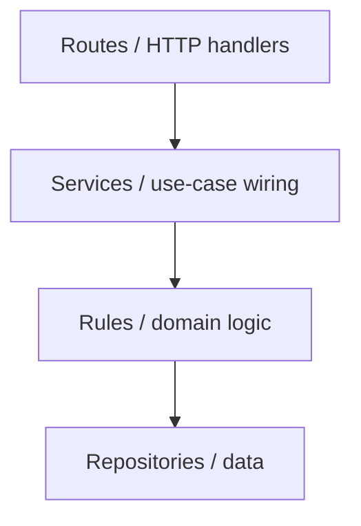
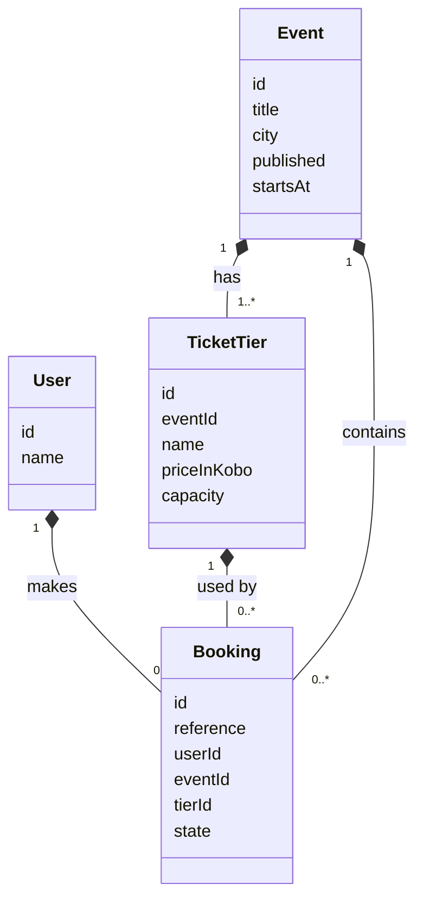
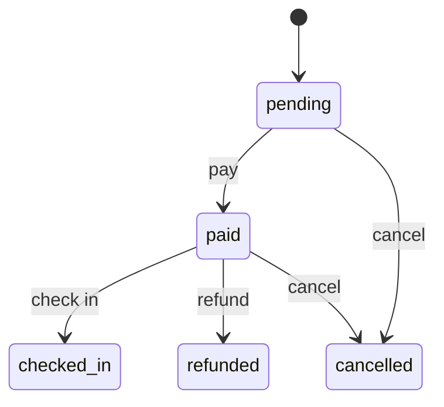

# Architecture

This project is a Node.js event ticketing system written in ES modules. It is
organized in layers so that the HTTP layer delegates business decisions
downwards and never decides them itself.

## Top-level layout

- `src/http/` — Node HTTP server, router, JSON body parsing, static file
  serving, and the app factory that wires routes together.
- `src/domain/` — pure business logic: event search, sorting, waitlist queue,
  inventory capacity, booking state transitions, and ID generation. No HTTP
  imports anywhere in this layer.
- `test/` — Node built-in tests for each module, run with `node --test`.
- `docs/` — build specs, milestones, user stories, and the AI log.
- `public/` — static files served by the HTTP layer.
- `scripts/` — one-off demo or benchmark scripts.

## Layer diagram

Dependencies point downward only. Upper layers may call lower layers, never
the reverse.

- Routes / HTTP handlers may translate an HTTP request into a call to a
  service or rule, and may return a response.
  They must not contain business rules.
- Services / use-case wiring may coordinate rules and repositories for one
  user-facing action.
  They must not redefine business rules that already belong in the rules layer.
- Rules / domain logic may contain pure business logic such as booking state
  transitions, inventory rules, waitlist order, sorting, and event search.
  They must not import Node HTTP modules or depend on the web server.
- Repositories / data may store and retrieve entities.
  They must not contain HTTP handling or UI concerns.

## Data model

This diagram describes the intended entities and relationships for the
ticketing system. It is part of the architecture, not a claim that every
relationship is already implemented.

## Booking lifecycle

States:

- `pending`
- `paid`
- `cancelled`
- `refunded`
- `checked_in`

Permitted transitions:

- `pending` → `paid`
- `pending` → `cancelled`
- `paid` → `checked_in`
- `paid` → `refunded`
- `paid` → `cancelled`

Final states:

- `cancelled`
- `refunded`
- `checked_in`

Final states accept no further transitions.

## Cross-cutting rules

- Money is stored as whole numbers in the smallest unit (kobo), never decimals.
- Inputs are validated before any state changes.
- Search and sort functions must not mutate the original list.
- The waitlist is first-in-first-out.
- A failed operation must never change any data.
